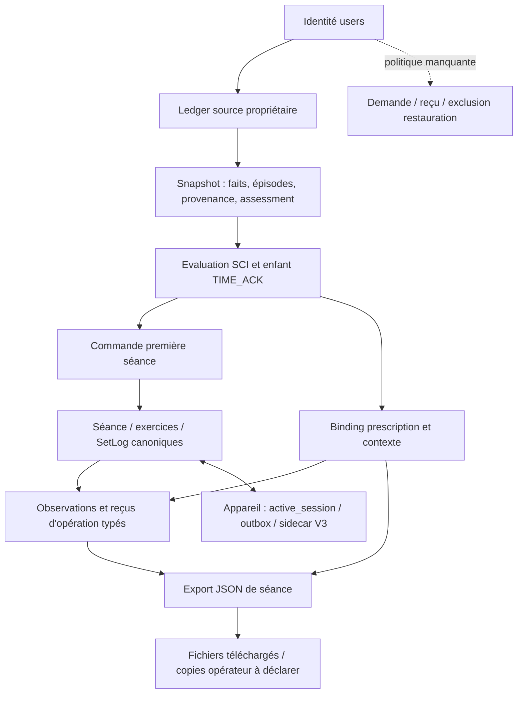

# DATA-ACT-01 — graphe de copies étendu et PLAN sept tables

Lecture statique du code à `fe9f6e9`, sans connexion DB. Le snapshot historique
[23 tables](../../MOB03_ACCOUNT_DATA_GRAPH.json) reste intact et daté : il n'est
pas présenté comme un inventaire complet actuel. Compléments ci-dessous depuis
[le modèle courant](../../../app/models/first_plan_runtime.py) et
[la frontière livrée](../../plan/blueprint-first-session-runtime/DATA_BOUNDARY.md).
Présence d'une déclaration ORM/migration ne prouve pas son déploiement.

## Sept tables PLAN présentes dans le code

| Table | Données/copied facts et relations déclarées | Conséquence DATA, décision ouverte |
|---|---|---|
| blueprint_source_events | owner_id→users ; révision, request_id/digest, kind/payload_json, recorded_at. Déclarations/préférences/rencontres et observations acquises via ledger | C08 : finalité des acquisitions et conservation des corrections/retraits historiques ; pas une nouvelle chronologie BodyMeasurement |
| owned_blueprint_snapshots | owner_id→users ; snapshot_json/digest, as_of/révision, request_id. Copie cohérente des faits, provenance, épisodes/pins et consent_assessment | C08 : vraie copie personnelle immuable ; suppression d'une source ne prouve pas celle du snapshot |
| first_plan_evaluations | owner_id→users ; FK composite owner/snapshot et owner/parent ; request_json/result_json, source revision/génération ; EVALUATE ou TIME_ACK enfant | C08 : copies SCI et ack exact, pas consentement DATA ; historique conservé lors de revalidation, aucune durée légale déduite |
| first_session_requests | owner_id→users ; owner/évaluation et session/owner ; body_json/digest, CREATED/DENIED/CANCELLED, session scientifique, code terminal ; CREATED unique par owner | C08/C11 : commande/reçu idempotent et tombstone d'annulation ne sont pas un registre d'effacement de compte ; purge sans politique peut rouvrir un doublon |
| first_plan_execution_bindings | owner_id→users ; session/owner, owner/évaluation ; immutable_payload_json, version, scientific_session_id, digest | C08 : prescription/contexte/mapping réels distincts des faits SetLog ; export les copie |
| first_plan_set_observations | owner_id→users ; session/owner→binding, exercice/session, série/exercice ; op_id, revisions, observation_json/receipt_json | C08 : append-only et preuve de rejeu ; ne pas perdre les réglages typés ou transformer kg affichés/par haltère en masse totale |
| first_plan_runtime_authorities | clé de profil, génération/état, publication_json/digest, approval_ref ; **pas owner_id** | Autorité opérationnelle globale ; ne pas la purger pour un compte, ni promettre qu'une référence d'approbation opérationnelle est dépourvue de toute information sans inventaire réel |

Les six tables possédées ont FK vers users **sans ondelete CASCADE** et gardes
ORM before_update/before_delete `immutable_plan_evidence`. Les FK internes sont
composites aux frontières pertinentes. Le futur effacement exige politique,
exception et design explicites ; aucun contournement des gardes n'est proposé.
Un simple DELETE users ne réalise pas le périmètre et une anonymisation UPDATE
ne respecte pas ces invariants. Les trois indexes composites sur tables de
séance ne constituent pas trois nouvelles catégories de faits.

## Liens de copies et limites observées

Le diagramme montre des copies logiques, pas uniquement des FK ni un ordre
d'effacement approuvé. Les sorties réseau, processus mémoire, logs et copies
d'infrastructure restent à inventorier par l'opérateur réel.

| Emplacement / code lu | Fait observé | Limite / réponse requise |
|---|---|---|
| snapshots.py | consent_assessment fixe `UNAVAILABLE`, purpose_ref/revision/receipt_ref null | Pas de registre DATA pertinent admis ; ni BodyConsent ni TIME_ACK ne le remplissent implicitement |
| planV3Journal.ts | journal_v3_set_operations stocke owner/session/exercice/série, fact_json, révisions ; joint outbox ; active_session stocke le snapshot local | C09 doit couvrir faits non envoyés **et** acquittés/refusés/résolus. La preuve du compte courant ne détermine pas le propriétaire d'un journal legacy inconnu |
| journal.ts / accountRequestStore.ts / ownershipStore.ts | reset() touche cinq tables legacy, pas le sidecar V3 ; intentions et owner_retirements séparées ; garde de propriétaire retiré existante | reset() n'est pas un effaceur de compte complet ; ne pas le câbler ni supprimer la marque de sécurité sans politique. Préserver les partitions d'autrui et inconnues |
| export_builder.py + execution.py | JSON séance ajoute `first_plan_execution` (binding, références snapshot/évaluation, observations/reçus), permission NOT_ASSERTED_BY_EXPORT | Export de séance typé livré, **pas preuve d'export complet des six tables** : sources, snapshot entier et inputs/results SCI n'y sont pas tous énumérés |
| build_csv_text | refus HTTP409 `typed_json_export_required` pour séance scientifique | Pas de conversion CSV appauvrie ; informer et définir futur périmètre export, sans régression par fallback |
| backup_sessions.py | build_json_payload(db) puis build_csv_text(db), sans user_id ; écrit les deux seulement après les builds | Helper multi-propriétaires potentiel ; sur PLAN, le refus CSV empêche sa sortie normale. Ce helper n'est pas une sauvegarde PLAN complète. Définir inventaire/config opérateur et stratégie typée avant promettre la restauration |
| restore.py | refuse schéma PLAN présent ou payload marqué scientifique/first_plan_execution | Garde de non-perte existante ; aucune restauration PLAN complète ni exclusion post-effacement prouvée par ce refus |
| account_deletion_requests.py | métadonnées workflow séparées sans FK users, owner_id résiduel et capacité hashée/expirante | Une table proposée supplémentaire au métier/PLAN, non servie : D07 doit décider ce lien résiduel, pas l'effacer implicitement avec users |

Aucun backup/restore/export réel n'a été lancé. Le défaut local de rétention
des scripts n'est ni la configuration déployée ni une décision du responsable.
